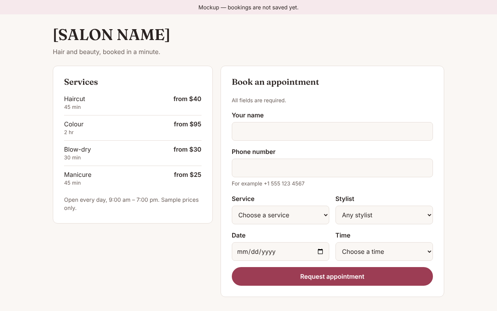

# Project 1: AI agent team

| Role | File |
|---|---|
| Project Leader (Aisyah) | CLAUDE.md (the main Claude Code session) |
| Developer (Ravi) | .claude/agents/developer.md |
| Database Manager (Mei) | .claude/agents/database-manager.md |
| Tester (Daniel) | .claude/agents/tester.md |
| Security Checker (Farid) | .claude/agents/security-checker.md |

Other folders:
- `agent-office/`: the visual office dashboard.
- `tasks/`: task briefs for the team. Start with `tasks/001-salon-appointment-mockup.md`.

## Using the team in Claude Code
1. Start a new session on this repository.
2. Ask: "Which subagents are available?" to check the team is loaded.
3. Give a task, for example: "Read tasks/001-salon-appointment-mockup.md and run it with the team."

To add or change a teammate, ask Claude Code ("create a designer subagent that…")
or edit the files in .claude/agents/.

Docs: https://code.claude.com/docs/en/sub-agents

## Projects done by the team

| Project | Built by | Checks | Try it |
|---|---|---|---|
| Task 001: Salon appointment page (mockup) | Aisyah, Ravi, Daniel, Farid | Tests: PASS · Security: CLEAR TO SHIP | [mockups/salon-appointment.html](mockups/salon-appointment.html) |

The same list appears in the Agent Office dashboard under "Projects done by the team".
To add a project, add an entry to `PROJECTS` in `agent-office/index.html` and a row here.

## Android apps (APK)

The team can turn an app into an Android APK (built with Capacitor; see `CLAUDE.md`).

- **Download without any tools:** every push that changes `apps/` builds the APKs on GitHub. Open the **Actions** tab, pick the latest **Android APK** run, and download **apks** under Artifacts.
- **Build here:** `scripts/setup-android-sdk.sh` once, then `export ANDROID_HOME=~/android-sdk` and `scripts/build-apk.sh apps/<name>`. The APK appears in `dist/`.
- **Install on your phone:** copy the APK to the phone, open it, and allow "install unknown apps" when Android asks. Debug APKs are for testing only.
- **Releasing:** a signed release APK or a Play Store listing needs a signing key kept in GitHub secrets (`ANDROID_KEYSTORE_BASE64`, `ANDROID_KEYSTORE_PASSWORD`, `ANDROID_KEY_ALIAS`, `ANDROID_KEY_PASSWORD`) and a Google Play developer account. The team will ask before doing either.
