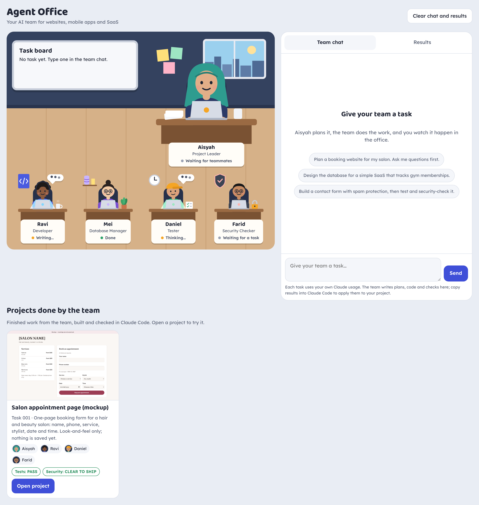
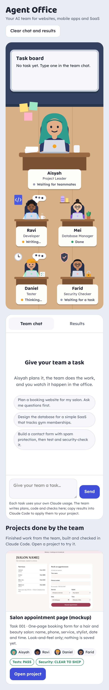

# Agent Office dashboard

`index.html` is the visual office (Aisyah, Ravi, Mei, Daniel, Farid).

How it works:
- Give a task in the team chat, for example "Make a mobile app to track my daily water intake".
- Aisyah asks questions if needed, then plans. Mei plans the data (when the app stores records), Ravi builds the app, Daniel tests it (including loading it in a hidden test box to catch errors), Farid checks security, and Ravi fixes what they find (one round).
- The chat shows only short updates and questions; no code.
- The finished app appears under "Projects done by the team". Web apps open full size, mobile apps in a phone frame. Projects are saved in the page's shared store.
- Mobile apps have a "Build APK" button: it copies an instruction (with the app's code) to paste into Claude Code, which builds the Android APK with `scripts/build-apk.sh`.
- Apps run in a locked (sandboxed) preview, so they cannot reach the dashboard or your data.

| Desktop | Phone |
|---|---|
|  |  |

Important: the live team replies only work when the page is opened inside Claude
(as a published Claude artifact), because it uses Claude's built-in "ask Claude" feature.
Opened anywhere else, the office shows but the team cannot reply.

Live version: https://claude.ai/artifact/NZ5Pxvre6hvAFrscVEHNdT

In the future, Claude Code can turn this into a standalone app that calls the Claude API
with your own API key (the team's role instructions are in ../.claude/agents/ and ../CLAUDE.md).
